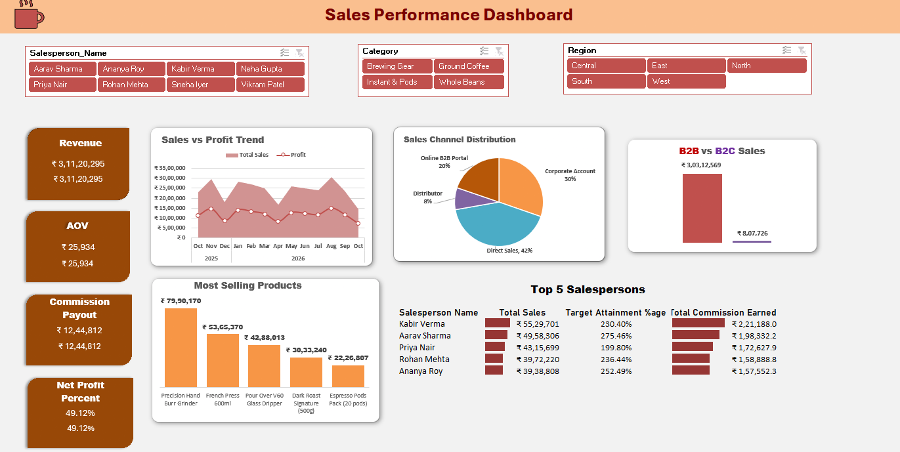

# ☕ Coffee Co. Sales Performance Dashboard



An interactive, executive-ready Excel dashboard designed to analyze multi-relational retail sales data for a specialty coffee business. Built using the **Excel Data Model**, custom DAX metrics, dynamic Pivot Tables, and interactive cross-filtering.

---

## 📌 Project Overview
This project provides an end-to-end breakdown of revenue, sales volume, profitability, sales channel performance, and salesperson target attainment across product categories and regions.

### 🎯 Key Performance Indicators (KPIs)
* **Total Revenue:** ₹3,11,20,295
* **Average Order Value (AOV):** ₹25,934
* **Total Commission Payout:** ₹12,44,812
* **Net Profit Margin:** 49.12%

---

## 🛠️ Technical Architecture & Features

### 1. Multi-Relational Data Model
* Structured around a relational schema linking `Sales Transactions` with lookup table for `Salespersons`.
* Custom DAX metrics and dynamic Pivot Table calculations for accurate profit tracking and commission calculation.

### 2. Visual Analytics & Reporting Layout
* **Sales vs. Profit Trend:** Dual-axis area and line visual tracking revenue trajectory alongside net profitability month-over-month.
* **Sales Channel Distribution:** Categorical breakdown highlighting revenue split across Direct Sales (42%), Corporate Accounts (30%), Online B2B Portal (20%), and Distributors (8%).
* **B2B vs. B2C Breakdown:** High-level performance metric comparing enterprise sales (₹3.03 Cr) against retail consumers (₹8.07 L).
* **Product Volume Analysis:** Highlights top-performing SKUs (Precision Hand Burr Grinder, French Press 600ml, V60 Glass Dripper).
* **Top 5 Salespersons Leaderboard:** Executive summary evaluating individual rep sales volume, target attainment percentages (up to 275.46%), and commission payouts.

---

## 🚀 How to View & Use
1. Clone or download this repository:
   git clone https://github.com/your-username/coffee-sales-dashboard.git
2. Open `Coffee_Sales_Performance_Dashboard.xlsx` in **Microsoft Excel 2019 or later** (or Excel 365).
3. The workbook contains the following sheet architecture:
   * **`Dashboard`**: The main interactive visualization interface with slicers and KPI cards.
   * **`Data Model / Lookup Tables`**: Source data sheets containing sales transactions, salesperson lookup table, and product categories.
4. Interact with the **Salesperson**, **Category**, and **Region** slicers at the top of the `Dashboard` sheet to filter the views dynamically.

---

## 💼 Skills Demonstrated
* **Data Modeling & Analytics:** Relational database setup, Data Model architecture, DAX logic, Pivot Tables.
* **Dashboard Design & UX:** Dark brown/warm color palette, card-container UI layout, KPI hierarchy, interactive visual alignment.
* **Business Intelligence:** Commission modeling, revenue forecasting, channel margin analysis, salesperson performance tracking.

---

## 📁 Repository Structure
```text
├── Dashboard/
│   └── coffee_company_sales_dashboard.xlsx # Complete workbook (Data Model, Source Data & Dashboard)
├── Screenshots/
│   └── Dashboard_overview.png                 # Main preview image
|   └── Filtered_Dashboard.png
└── README.md                                   # Project documentation
